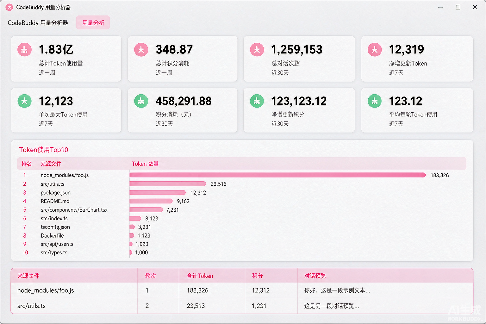
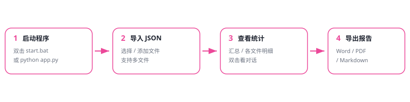

# CodeBuddy 用量分析器

> 解析 CodeBuddy 导出的对话 JSON，一键统计**会话数量 / 对话轮次 / Token 消耗 / 消耗积分**，支持**导入多个文件一起汇总**，并可将全部结果导出为 **Word / PDF / Markdown**。
>
> 纯 Python 实现，**零第三方依赖**（仅用标准库 + Tkinter 原生桌面界面），Windows / macOS / Linux 均可运行。



---

## ✨ 功能特性

- 📊 **多文件汇总分析**：可一次性导入多个 CodeBuddy 导出 JSON，自动区分「每个文件各自的消耗」与「所有文件的总计」。
- 🔢 **大数字友好显示**：自动把动辄上亿的 Token 换算成 `X.XX亿 / X.XX万 / X.XX千`，同时保留精确值（带千分位）。
- 🗂️ **各文件消耗明细**：按「合计 Token」降序排列，一眼看清哪个文件最费。
- 💬 **查看每轮对话内容**：逐轮明细带「对话预览」，双击任意一行即可查看该轮完整的**用户提问**与 **AI 回复**（已自动过滤系统注入噪声）。
- 💾 **一键导出报告**：支持导出 **Word(.docx) / PDF(.pdf) / Markdown(.md)**，通过系统「另存为」对话框自由选位置和文件名，包含总计 + 各文件明细 + 逐轮明细（含对话内容）。
- 🎨 **浅色 + 粉色风格桌面界面**：基于 Tkinter，无需浏览器、不占端口。

---

## 🚀 快速开始

### 环境要求

- 已安装 **Python 3.8+**（Windows 用户建议从 [python.org](https://www.python.org/downloads/windows/) 安装，勾选 “Add Python to PATH”）。
- Tkinter 在主流 Python 安装包中**默认自带**（标准库），无需额外安装。

### 使用方法



1. **启动程序**
   - 最简单：双击项目里的 `start.bat`，会自动弹出分析窗口。
   - 或手动运行：在终端进入项目目录，执行 `python app.py`（Linux/macOS 用 `python3 app.py`）。

2. **放入 / 导入数据**
   - 把你的 CodeBuddy 导出 JSON 放到 `data/` 目录下，启动后会**自动分析**该目录下的全部 JSON。
   - 或在界面里：
     - `📂 选择文件（可多选）`：选择若干文件（**替换**当前选择）；
     - `➕ 添加文件`：在已有基础上**追加**更多文件；
     - `🗑 清空`：清空已选。

3. **查看结果**
   - 顶部 8 张卡片显示**全部文件总计**（文件数 / 会话数 / 对话轮次 / 输入·输出·合计 Token / 缓存命中及占比 / 消耗积分）。
   - 多文件时自动出现「各文件消耗明细」表。
   - 底部「逐轮明细」表列出每一轮的 Token 与积分，**双击任意一行**可查看该轮完整对话。

4. **导出报告**
   - 点击 `💾 导出报告`，选择格式（Word / PDF / Markdown），点击「选择保存位置并导出」，在弹窗中自由指定保存路径与文件名即可。

---

## 📁 项目结构

```
codebuddy-usage-analyzer/
├── app.py              # 核心程序：解析 + 分析 + Tkinter 桌面界面 + 三种格式导出（纯标准库）
├── start.bat           # Windows 一键启动脚本（双击即开窗口）
├── README.md           # 使用文档（本文件）
├── .gitignore          # 忽略个人数据与缓存
├── data/               # 存放你的 CodeBuddy 导出 JSON（*.json 已被 gitignore 排除）
│   └── README.md
└── docs/
    ├── preview.png     # 界面预览图
    └── flow.svg        # 使用流程图
```

---

## 🧮 统计口径说明

| 指标 | 含义 |
|---|---|
| 会话数量 | JSON 中的 `conversations` 个数 |
| 对话轮次 | 每个会话下 `requests` 的个数（即一次提问 + 一次回复算一轮） |
| 输入 / 输出 / 合计 Token | 取自每轮 `usage` 的 `inputTokens` / `outputTokens` / `totalTokens` |
| 缓存命中 Token | 取自每轮 `usage.cacheTokens`，并给出占输入的百分比 |
| 消耗积分 | 每轮 `usage.credit` 之和（已验证为逐轮独立值，非累计快照） |

> ⚠️ **关于 Token 为什么这么大**：在 ask（问答）模式下，每一轮都会把**历史上下文重新喂给模型**，因此前面轮次的上下文会被重复计入后续轮次的输入 Token。这是按 API 实际调用计费的口径，并非重复统计错误。其中命中缓存（`cacheTokens`）的部分能大幅节省实际消耗。

---

## 💡 常见问题

**Q：为什么 `data/` 下的 JSON 没有一起上传到 GitHub？**
> 因为导出文件包含你的个人聊天内容且体积较大，已在 `.gitignore` 中排除。请把自己导出的 JSON 放进 `data/` 后本地使用。

**Q：PDF 打开后中文正常吗？**
> 本工具生成的 PDF 使用规范的「标准 CJK 字体」方案（STSong-Light / UniGB-UCS2-H），主流阅读器（Adobe、Edge/Chrome、Sumatra 等）均可正常显示中文；极少数纯 ASCII 阅读器可能不显示中文，此时请用 Word 或 Markdown 导出。

**Q：Mac / Linux 能用吗？**
> 可以。确保已安装 Python 与 Tkinter（Linux 需 `sudo apt install python3-tk` 之类），然后用 `python3 app.py` 启动。

**Q：支持多大的文件？**
> 已用约 60MB 的真实导出文件验证，解析耗时不到 1 秒。文件会按「路径 + 大小 + 修改时间」做缓存，重复刷新不重复解析。

---

## 📝 导出报告示例（Markdown 节选）

```markdown
# CodeBuddy 用量分析报告
> 生成时间：2026-11-06 09:35:00
> 分析文件数：1

## 一、全部文件总计
- **文件数量**：1
- **会话数量**：1
- **对话轮次**：67
- **输入 Token**：1.82亿（182,403,231）
- **输出 Token**：96.95万（969,516）
- **合计 Token**：1.83亿（183,372,747）
- **缓存命中 Token**：1.80亿（占比 98.45%）
- **消耗积分**：348.87

## 二、各文件消耗明细
| 文件名 | 会话数量 | 对话轮次 | 合计 Token | 消耗积分 |
| --- | --- | --- | --- | --- |
| xxx.json | 1 | 67 | 1.83亿 | 348.87 |

## 三、逐轮明细
| 来源文件 | 轮次 | 合计 Token | 积分 | 用户提问 | AI 回复 |
| --- | --- | --- | --- | --- | --- |
| ... | 第 1 轮 | ... | ... | 使用springboot+vue... | ... |
```

---

## 👤 署名

本工具由 **小洛学长** 开发并开源，供有相同统计需求的小伙伴免费使用。

如果你觉得有用，欢迎 Star ⭐、提 Issue 或 PR 一起完善～

> 博客 / 更多作品：小洛学长（阿洛博客 · lxttz.github.io）
